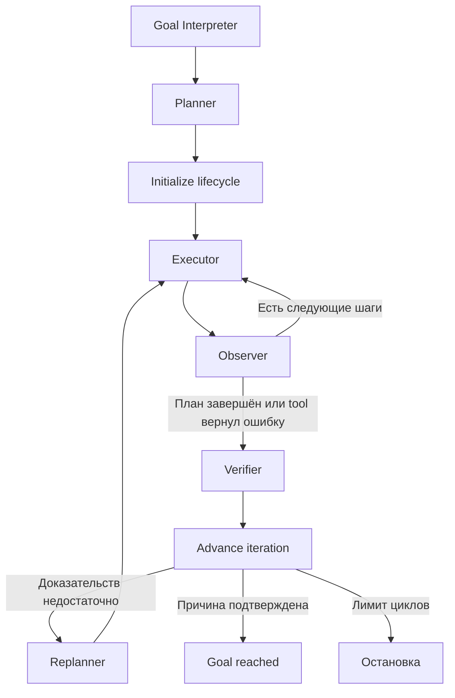

# my-autonomous-agent

## Week 9 Lesson 7

Общий лимит вызовов инструментов за расследование для всех итераций lifecycle.


 #### Идея

 Автономность агента — это самостоятельный выбор следующей проверки на основе наблюдений, а бюджет и executor задают границы этой самостоятельности.


#### Архитектура

> Обрати внимание: Verifier сейчас вызывается после выполнения всех шагов в текущем execution_plan либо после неудачного действия, а не после каждого успешного tool call.  
> Поэтому один lifecycle iteration может включать несколько read-only действий.

### Тест

Выполнить команду:
```
export OPENAI_API_KEY="sk-proj-..."; 
export OPENAI_MODEL="gpt-5-mini"; 
export LANGSMITH_TRACING=true; 
export OPENAI_BASE_URL="https://api.openai.com/v1"
```

Запустить LangGraph server
```
langgraph dev
```

Создай запрос 1:
```
Проверь, что у Deployment colvir-front-deployment
в namespace colvir-test кластера docker-desktop
количество готовых реплик не меньше текущего
желаемого количества из spec.replicas.
Ничего не изменяй.
```

```
Определи причину, по которой pod bbox-1 в namespace colvir-test
кластера docker-desktop находится в CrashLoopBackOff.
Ничего не изменяй.
```

```
Проверь, что у Deployment colvir-back-deployment
в namespace colvir-test кластера docker-desktop
количество готовых реплик не меньше текущего
желаемого количества из spec.replicas.
Ничего не изменяй.
```


```
Найди причину, почему Deployment payment-api
в namespace agent-lab кластера docker-desktop
не имеет готовых реплик.

Продолжай диагностику, пока не получишь подтверждаемую
причину либо не исчерпаешь бюджет расследования.

Критерии успеха:
1. Установлено фактическое состояние проблемного Pod.
2. Установлена конкретная непосредственная причина Not Ready.
3. Причина подтверждена фактами из результатов инструментов;
   указаны action_id и соответствующие поля или сообщения.
4. Объяснена связь между обнаруженной причиной
   и состоянием Not Ready.

Если доказательств недостаточно, не объявляй причину
подтверждённой. Укажи, какие проверки ещё нужны.

Используй только read-only инструменты.
Не изменяй Kubernetes.
Не выполняй команды внутри контейнеров.
Не восстанавливай приложение.
```