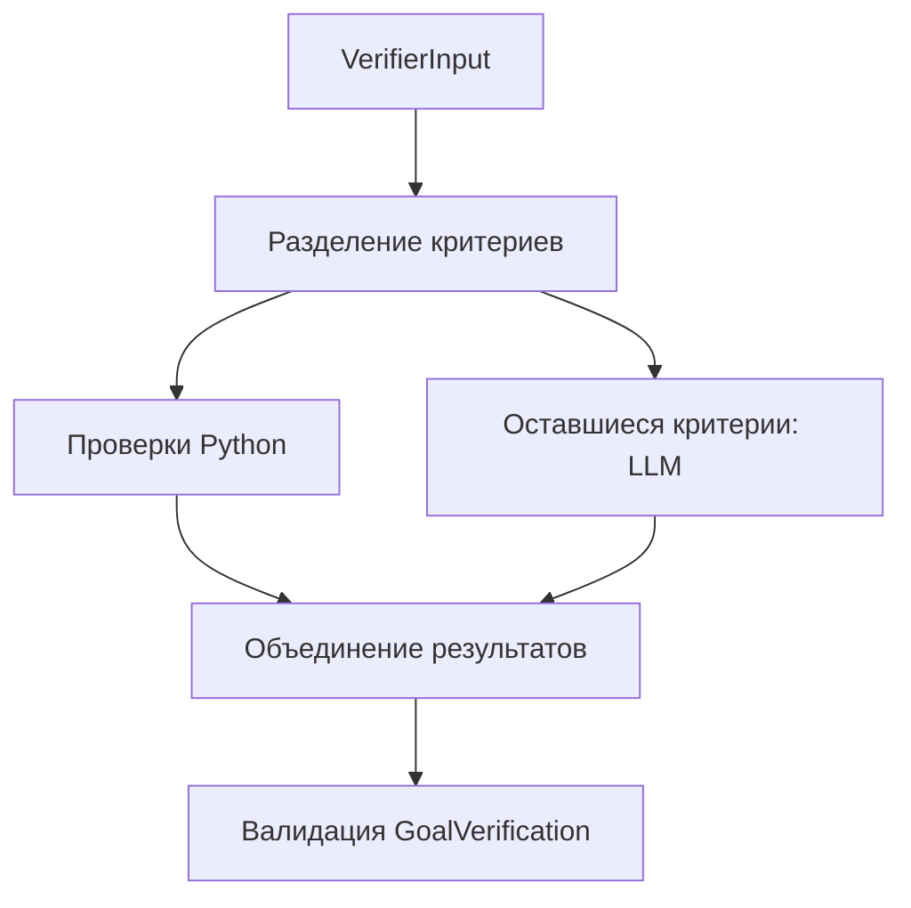

# my-autonomous-agent

## Week 9 Lesson 4
Проверять факты Python-кодом и не разрешать LLM переопределять результат.


#### Идея:
- LLM интерпретирует смысл: анализирует причины, сопоставляет логи и события, предлагает следующие проверки.
- Python проверяет формальные условия: сравнивает числа, проверяет состояния и принимает окончательное решение по таким критериям.

#### Правило
> Критерий, закреплённый за Python, вообще не передаётся LLM для оценки.


#### Архитектура Verifier


| Критерий                      | Проверяет                                             |
|-------------------------------|-------------------------------------------------------|
| Ready=True                    | Python                                                |
| Причина CrashLoopBackOff      | LLM на основании наблюдений                           |

> Если все критерии детерминированные, Verifier не вызывает LLM.

### Тест

Выполнить команду:
```
export OPENAI_API_KEY="sk-proj-..."; 
export OPENAI_MODEL="gpt-5-mini"; 
export LANGSMITH_TRACING=true; 
export OPENAI_BASE_URL="https://api.openai.com/v1"
```

Запустить LangGraph server
```
langgraph dev
```

Создай запрос:
```
Определи причину, по которой pod bbox-1 в namespace colvir-test
кластера docker-desktop находится в CrashLoopBackOff.
Ничего не изменяй.
```