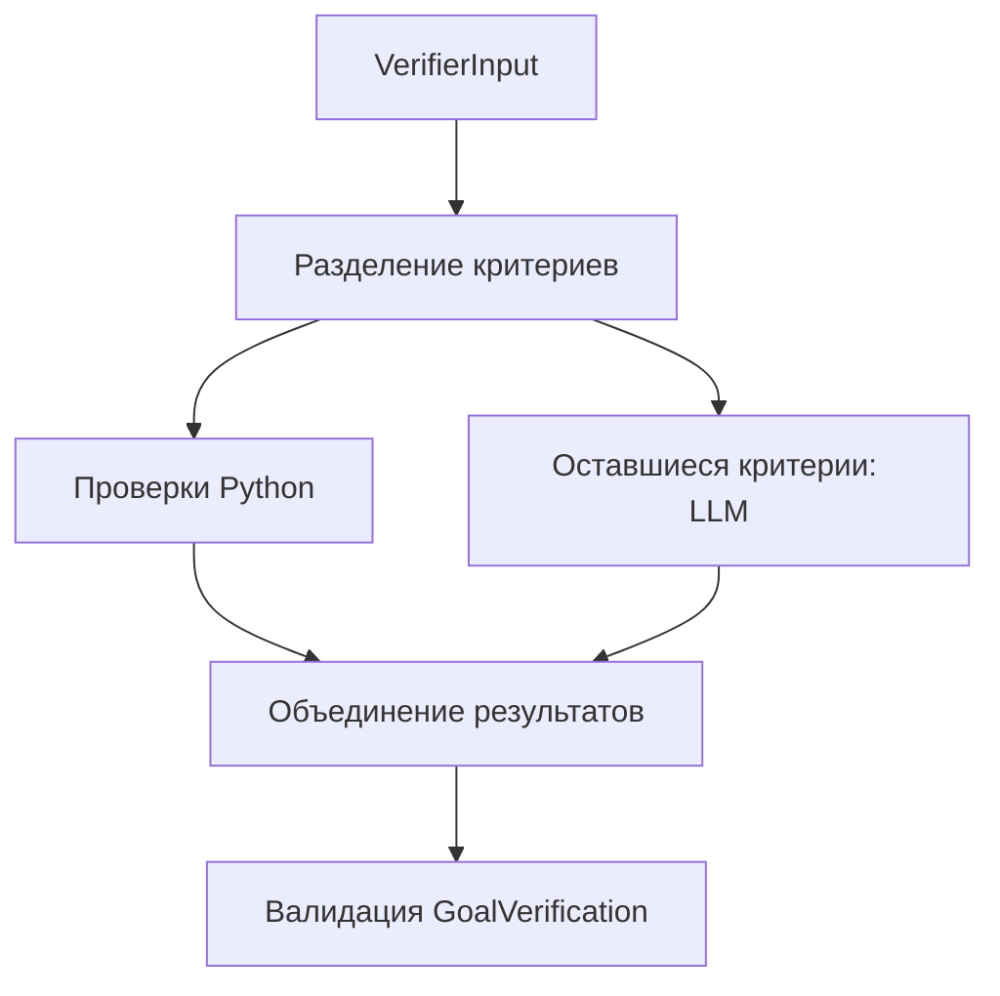

# my-autonomous-agent

## Week 9 Lesson 4
Проверять факты Python-кодом и не разрешать LLM переопределять результат.


#### Идея:
Что даелает LLM и Python:
- LLM интерпретирует смысл: анализирует причины, сопоставляет логи и события, предлагает следующие проверки.
- Python проверяет формальные условия: сравнивает числа, проверяет состояния и принимает окончательное решение по таким критериям.

Типы критериев успеха:
- `Семантические критерии успеха` проверяются LLM. 
- `Детерминированные критерии успеха` проверяются через `детерминированные правила` специальной функцией на Python. 

Что такое детеримированное правило и специальная функция Python:
- Детерминированное правило отвечает на вопрос `что проверить?`
- Функция Python отвечает на вопрос `как проверить?`   

`Детерминированое правило` для функции Python связано c:
- критерием успешности, котороый нужно достичь;
- ресурсом, который проверяем;

Example:
```
deterministic_rule_one_pod_ready= PodReadyRule(
    kind = "PodReady",
    criterion = "Pod 'bbox-1' in namespace 'colvir-test' on cluster 'docker-desktop' has status.conditions[type="Ready"].status == "True".",
    cluster_alias = "docker_desktop",
    namespace = "colvir-test",
    pod = "colvir-front-test"
)
```


#### Правило
> Критерий, закреплённый за Python, вообще не передаётся LLM для оценки.  
> Детерминированная функция Python точно проверяет заданное условие. И не исправляет неправильно выбранное условие.  


#### Архитектура Verifier


#### Описание Архитектуры 
| Нода                                              | Выполняет                                                                                                                        |
|---------------------------------------------------|----------------------------------------------------------------------------------------------------------------------------------|
| Goal Interpreter                                  | выбрал поддерживаемое детерминированное правило для конкретного Deployment.                                                      |
| Planner                                           | создал execution_plan c шагами.                                                                                                  |
| Executor                                          | выполнил шаг и вызвал инструмент, а также получил данные.                                                                        |
| Observer                                          | сохранил наблюдения observation со временем создания.                                                                            |
| Verifier                                          | выбрал функцию по типу правила, проверил пригодность данных и сравнил реплики. Результат связался с критерием через criterion.   |


#### Где использовать LLM, а где Python

Для твоего автономного SRE-агента граница выглядит так:
| Задача                                            | Подход.                                               |
|---------------------------------------------------|-------------------------------------------------------|
| Понять запрос пользователя                        | LLM                                                   |
| Составить план                                    | LLM                                                   |
| Объяснить связь ошибок в логах и событиях         | LLM                                                   |
| Предложить следующую проверку                     | LLM                                                   |
| Проверить Ready == "True"                         | Python (evaluate_pod_ready)                           |
| Проверить ready_replicas >= 3                     | Python (evaluate_deployment_replicas_ready)           |
| Проверить namespace и кластер                     | Python (evaluate_pod_ready)                           |
| Проверить свежесть observation                    | Python (evaluate_pod_ready)                           |
| Проверить зависимости шагов                       | Python (evaluate_pod_ready)                           |
| Проверить лимит итераций                          | Python (route_after_verification)                     |
| Проверить, разрешён ли инструмент                 | Python (executor_node)                                |
| Решить, нужен ли approval по политике             | Python (route_after_verification)                     |
| Объединить результаты всех критериев              | Python (verify_goal)                                  |
 

> Если все критерии детерминированные, Verifier не вызывает LLM.

Можно ли однозначно описать входные данные, условие и ожидаемый результат?  
Если да — обычно это задача обычного кода Python.  
Если требуется интерпретация неоднозначной информации — полезна LLM.  


#### Для подключения проверки Deployment в следующем расширении потребуется
1. Инструмент чтения Deployment.
2. Регистрация в каталоге Planner и реестре Executor.
3. Контракт правила с ресурсом и целевым количеством.
4. Проверка актуальности observation.
5. Отдельные тесты.


### Тест

Выполнить команду:
```
export OPENAI_API_KEY="sk-proj-..."; 
export OPENAI_MODEL="gpt-5-mini"; 
export LANGSMITH_TRACING=true; 
export OPENAI_BASE_URL="https://api.openai.com/v1"
```

Запустить LangGraph server
```
langgraph dev
```

Создай запрос 1:
```
Проверь, что у Deployment colvir-back-deployment
в namespace colvir-test кластера docker-desktop
количество готовых реплик не меньше текущего
желаемого количества из spec.replicas.
Ничего не изменяй.
```

